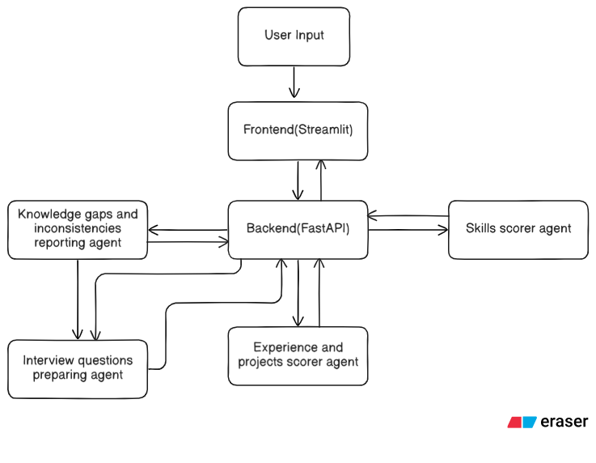

# AI HIRING ASSISTANT

## Setup Instructions
1. Clone the repository.
2. Create a virtual environment and install all the libraries in requirements.txt.
3. Create a .env file with your ```GROQ_API_KEY```.
4. Navigate to "backend" folder and run ```python main.py```.
5. Navigate to "frontend" folder and run ```streamlit run app.py```.

Open the browser, fill the job_description and candidate name. Drag and drop a resume to the resume field in ```.pdf or .txt``` format only or fill the placeholder by selecting text radio button.

## Architecture Design


## API Endpoints
For the request from frontend, there is one FastAPI endpoint hosted on localhost(127.0.0.1) at port 8000. Navigation URL:- ```http://127.0.0.1:8000/analyze/frontend```.

## Agent Design
### Working:-
A user inputs job description and a resume(in pdf or text) which goes to streamlit. This data is then posted to the FastAPI endpoint which:-
1. calls the ```experience and project scorer agent``` which reviews the resume with respect to job description and scores it.
2. calls the ```skills scorer agent``` which matches the required skills in job description and skills which user have and scores it.
3. calls the ```knowledge gaps agent``` agent which finds knowledge gaps, inconsistencies and unclear sections in the resume.
4. calls teh ```interview questions agent``` agent which also takes the output from ```knowledge gaps agent``` and job description to generate questions.

So 3 agents work independently and 1 agent is dependent on another agent.

### Scoring Methodology:-
The scoring is completely upto the LLMs we are using. There is no rule based scoring method.
Some instructions given to the agents for scoring are:-
1. In case of very high match and good level of projects or experience in the specified domain, score 9 or 10.
2. If there is lack of experience or project in specified domain score 1 to 5.
3. In case of not very high match but there are some very simple projects or experience in the specified field score 6 to 8 based on the level of project.

This makes the resume which are of low match to score low only and maintain consistency in the scores.

### Consistency Handling:-
The agents are provided not only the skills but are instructed to review the skills and projects sections more carefully giving them more priority over skills or education section so that there can be no keyword manipulation based on skills. The agents critically reviews each and every project and work experience to find if the person do actually have any experience in the listed skills or not.